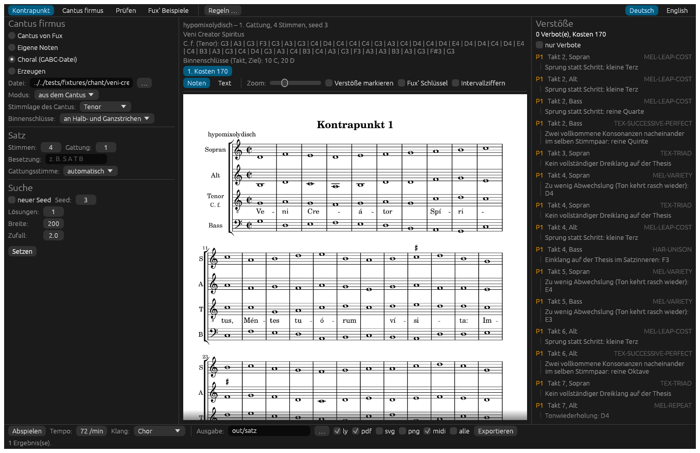

# fux-kontrapunkt

Regelbasierter Generator für Kontrapunkt im Palestrinastil nach Johann Joseph Fux,
*Gradus ad Parnassum* (1725). Das Programm erzeugt Cantus firmi in den Kirchentonarten und
Gegenstimmen in allen fünf Gattungen, zwei- bis sechsstimmig, dazu freie Sätze ohne Cantus firmus
im Stil Palestrinas, deren Stimmen einen lateinischen Text des Messordinariums singen und einander
imitieren. Aus solchen Sätzen setzt es ganze Messen in den Satzformen Palestrinas. Es prüft auch
eigene Sätze, mit Liedtext und Imitation.
Die Ausgabe erfolgt als LilyPond, PDF, MIDI und MusicXML. Es gibt das Programm `fux` für die
Kommandozeile, eine grafische Oberfläche und eine Web-Version.

**Umfang:** `fux mass`, die grafische Oberfläche und die Web-Version setzen ganze Messen,
wahlweise mit einem Kopfmotiv oder auf dem Choral des Kyriale, und schreiben sie als Buch,
wahlweise mit Mensurstrichen, und je Satz als MusicXML und MIDI; `fux check` prüft einen ganzen
Satz Teil für Teil. Regeln, Stufen und Grenzen stehen im [Regelkatalog](docs/regeln.md).

**Beispiele:** zehn erzeugte Sätze und eine Missa brevis (Beispiel 11) als PDF, MIDI, MuseScore und MusicXML in [examples/](examples/README.md), erzeugt mit `tools/make_examples.sh`. Nach einer Änderung allein am Notenbild setzt `tools/make_examples.sh --nur-notenbild 11` die Messe ohne Suche aus ihren Teilen neu, die das Skript in `target/beispiele/` aufhebt.

**Daneben: Fugen im Stil Bachs.** Das zweite Programm `fux-fuge` setzt zu einem gegebenen Thema
eine Fuge für zwei bis vier Stimmen (Antwort, Kontrasubjekt im doppelten Kontrapunkt,
Zwischenspiele aus Themenmaterial, Engführung oder Orgelpunkt) und prüft Sätze gegen gegebene
Akkorde, nach einem eigenen Regelkatalog, der an Bachs Fugen geeicht ist. Es ist eine eigene
Maschine in `crates/fux-bach` und lässt den Fux-Code unberührt. Anleitung in
[docs/fux-fuge.md](docs/fux-fuge.md), Regeln in [docs/regeln-bach.md](docs/regeln-bach.md), vierzig
erzeugte Fugen in [examples/fugen/](examples/fugen/README.md), die Seite für den Browser in
[web-fuge/](web-fuge/README.md).

## Bauen

```sh
cargo build --release
cargo test --workspace
```

Die Programme liegen danach unter `target/release/fux` und `target/release/fux-gui`. Für PDF, SVG
und PNG wird [LilyPond](https://lilypond.org) ab Version 2.24 benötigt; ein anderer Pfad lässt sich
mit der Umgebungsvariablen `FUX_LILYPOND` angeben. LilyPond-Quelltext und MIDI entstehen auch ohne
LilyPond. Die grafische Oberfläche braucht unter Linux zum Bauen die ALSA-Entwicklungsdateien
(`libasound2-dev` bzw. `alsa-lib`).

Ob eine Änderung Ausgaben bewegt, zeigt `tools/compare_outputs.sh`: `base REV` setzt einen festen
Satz Anfragen mit dem Stand REV, `check REV` dieselben mit dem Arbeitsbaum und vergleicht alle
Dateien und Berichte Byte für Byte (Ergebnisse in `compare/`, nicht im Repository).

## Verwendung

```sh
fux corpus                    # Fux' 123 Notenbeispiele auflisten
fux corpus --cantus           # Fux' Cantus firmi mit ihren Namen (fux:dorian, …)

# Ein Beispiel aus dem Gradus setzen, mit Originalschlüsseln und Intervallziffern
fux render --example 84a --clefs original --figures -o out/fig84a

# Einen eigenen Satz über einem Cantus von Fux setzen
fux render --cf fux:dorian --voice "S=a'1 a' g' a' b' c'' c'' b' d'' cis'' d''" -o out/eigen

# Einen Cantus in Notennamen und eine Gegenstimme in LilyPond-Notation
fux render --mode dorisch --cf "D4 F4 E4 D4" --voice "S=a'1 a' g' a'" -f pdf,midi

# Cantus firmi erzeugen: drei Vorschläge, reproduzierbar über den Seed
fux cf --mode phrygisch --length 12 --count 3 --seed 7

# Gegenstimme in der 1. Gattung über (oder mit --below unter) einem Cantus von Fux
fux cp --cf fux:dorian --count 3 --figures -o out/dorisch
fux cp --cf fux:aeolian --below

# 2. bis 5. Gattung: Halbe, Viertel, Synkopen, blühender Kontrapunkt
fux cp --cf fux:dorian --species 2
fux cp --cf fux:phrygian --species 3 --below --details
fux cp --cf fux:ionian --species 4 --seed 3
fux cp --cf fux:mixolydian --species 5 --count 3

# Drei bis sechs Stimmen wie bei Fux: eine Stimme in der Gattung, die übrigen in Ganzen
fux cp --cf fux:dorian --voices 4 --species 3
fux cp --cf fux:phrygian --voices 3 --cf-voice B --species 4 --voice S
fux cp --cf fux:ionian --parts "S A T T B" --cf-voice A --species 5 --voice T

# Eine Choralmelodie (GABC) als Cantus: Binnenschlüsse an den Gliederungsstrichen, Text darunter
fux cp --cf tests/fixtures/chant/veni-creator.gabc --cf-voice T --voices 4 -f pdf,midi
fux cp --cf tests/fixtures/chant/pange-lingua.gabc --cf-voice T --voices 5 --species 4 --cadences full

# Binnenschlüsse selbst setzen: Takte, in denen eine Klausel ankommt
fux cp --cf fux:dorian --cadences 4

# Ohne --cf wird zuerst ein Cantus erzeugt
fux cp --mode mixolydisch --length 12 --seed 4

# Einen Satz prüfen: Verstöße mit Takt, Regel und Stufe; --mark setzt ein PDF mit Markierungen
fux check --cf "D4 F4 B4 A4 G4 F4 E4 D4" --mark -o out/pruefung

# Regeln und ihre Einstellungen; Häufigkeit in Fux' Beispielen
fux rules
fux rules --id MEL-REPEAT
fux rules --corpus

# Nach Jeppesens Regeln setzen; wie oft Fux selbst gegen sie verstößt
fux cp --cf fux:dorian --species 3 --profile jeppesen
fux rules --corpus --profile jeppesen

# Freier Satz ohne Cantus firmus: alle Stimmen frei, Schlüsse als Klauseln; die Stimmen singen
# einen Text (Standard: Kyrie I), drei bis fünf Stimmen imitieren einander
fux free --mode dorisch --voices 4 --seed 1
fux free --mode phrygisch --voices 3 --text christe --eleison 3 --count 3 --details
fux free --mode ionisch --voices 4 --text gloria:1-5 -f pdf,midi,musicxml -o out/gloria
fux free --mode dorisch --voices 3 --text "Ad te le-vá-vi á-ni-mam me-am." --repeat keine
fux free --mode dorisch --voices 4 --imitation aus             # ohne Imitation
fux free --mode phrygisch --voices 3 --cadences 6:A --length 12 --accents aus   # ohne Imitation
fux free --mode ionisch --parts "S A T B" --text none --length 16 --cadences none   # ohne Text

# Imitation: den Plan zeigen (Punkte, Köpfe, Einsätze), ohne Suche
fux free --voices 4 --seed 1 --plan
# Soggetti aus dem Choral des Kyriale (Kyrie IX, im Modus des Chorals), aus einer GABC-Datei
# zu einem eigenen Text, aus eigenen Noten (je Punkt ein Kopf, | dazwischen)
fux free --voices 4 --subject chant --seed 2 -f pdf,midi -o out/kyrie-ix
fux free --voices 4 --text "Lau-dá-te Dó-mi-num, / om-nes gen-tes." \
  --subject chant:tests/fixtures/chant/iste-confessor.gabc
fux free --voices 4 --subject "d'1 d'2 a'2 g'4 f'4 e'2 d'1 | a'1 a'2 g'2 f'2 e'2 d'1"
# Einsätze selbst festlegen: Reihenfolge, Abstände in Takten und Intervalle je Punkt (; dazwischen)
fux free --voices 4 --text agnus --order "A S T B; T B; S A" --delays "2 2 2; 1; 1" --seed 1
fux free --voices 4 --order "T B A S" --intervals "d 0 d" --pairs aus --answer real

# Texte des Ordinariums: Silben, betonte Silben, Sinnabschnitte, Zäsuren, automatische Länge
fux text --list
fux text benedictus
fux text "Ad te levavi animam meam."

# Einen Satz mit Liedtext prüfen (MusicXML): Dateien von fux nennen ihren Text, Modus,
# Binnenschlüsse und den Plan ihrer Imitation selbst; sonst erkennt fux den Abschnitt oder
# Bereich, oder man nennt ihn
fux check --musicxml out/gloria.musicxml
fux check --musicxml anderer.musicxml --text gloria:1-5 --cadences 13:A,22:F,26:G
fux check --musicxml anderer.musicxml --imitation erkennen   # Imitationspunkte suchen und nennen

# Freie Gegenstimmen um einen Cantus in Ganzen, auch mit Text (der Cantus singt ihn nicht)
fux cp --cf fux:dorian --species 0 --voices 4
fux cp --cf fux:dorian --species 0 --voices 3 --text kyrie

# Eine ganze Messe (Standard: Missa brevis, dorisch, S A T B). Zuerst der Plan ohne Suche: Sätze,
# Teile, Neubeginn, Schlussstufen und die geschätzte Zeit
fux mass --plan --seed 1
fux mass --preset normal --voices 5 --mode mixolydisch --plan --details
# Die Messe setzen, bis zu vier Teile zugleich (vierstimmig auf acht Kernen etwa 2 Minuten):
# jeder fertige Teil sofort in out/messe.teile/, am Ende das Buch out/messe.pdf (ein Buchteil je
# Satz, eine Partitur je Abschnitt), je Satz MusicXML und MIDI (out/messe-1-kyrie.musicxml …
# out/messe-6-agnus.mid), der Bericht in out/messe.txt; --jobs 1 setzt die Teile nacheinander,
# mit denselben Noten
fux mass --mode phrygisch --seed 1 -o out/messe
# Nach einem Abbruch (Strg-C) fortsetzen; einzelne Teile neu setzen, auch mit eigenem Seed. Form,
# Modus, Chor, Seed, Choral und Kopfmotiv kommen aus den Dateien, die übrigen Angaben müssen die
# des Setzens sein
fux mass --resume -o out/messe
fux mass --only credo/3,christe -o out/messe
fux mass --only christe --seed 5 -o out/messe
# Das Notenbild ändern, ohne neu zu setzen, ebenso mit den Angaben des Setzens: Mensurstriche
# (Taktstriche nur zwischen den Systemen, übergebundene Noten als eine Note), Originalschlüssel,
# ohne die Intonation vor Gloria und Credo; in MusicXML die Stimmen verbergen, die einen Abschnitt
# lang schweigen
fux mass --resume --mensurstriche --clefs original --intonation aus -o out/messe
fux mass --resume --tacet verbergen -f musicxml -o out/messe
# Nach Änderungen an Regeln, Tabellen, Plan oder Generator eine fertige Messe aus ihren Teilen neu
# schreiben, wie sie gesetzt wurde: ohne Suche und ohne Plan und Regelprofil zu vergleichen, mit
# den Angaben des Notenbilds; Angaben des Plans und --seed weist es ab
fux mass --rewrite --mensurstriche -o out/messe
fux mass --rewrite --movements kyrie,agnus -f musicxml,midi -o out/messe
# Mit Kopfmotiv: Gloria, Credo, Sanctus und Agnus Dei I beginnen mit dem ersten Soggetto des
# Kyrie I. Oder auf dem Choral des Kyriale (Messe IX mit Credo I; iv: Kyrie IV), ohne --mode jeder
# Satz im Modus seines Gesangs
fux mass --motif an --seed 1 -o out/kopfmotiv
fux mass --chant ix --plan --seed 1
fux mass --chant iv --mode dorisch -o out/choral
# Sätze, Neubeginn und Schlussstufen selbst festlegen, unter eigenem Namen; --resume braucht dann
# dieselben Angaben (sonst setzt es nichts und endet mit 1; ohne --movements setzt es die übrigen
# Sätze dazu)
fux mass --movements kyrie,agnus --voices 3 --imitation "christe=aus" --endings "christe=A" \
  -o out/kyrie-agnus
fux mass --movements kyrie,agnus --voices 3 --imitation "christe=aus" --endings "christe=A" \
  -o out/kyrie-agnus --resume --mensurstriche
# Einen Teil prüfen: wiederholt den Bericht seiner Suche
fux check --musicxml out/messe.teile/3-02-credo_5-7.musicxml
# Einen ganzen Satz prüfen: wiederholt den Bericht jedes seiner Teile, in den Takten des Satzes
fux check --musicxml out/messe-3-credo.musicxml
# Einen einzelnen Satz wie einen Teil einer Messe auf der Quinte schließen lassen
fux free --voices 3 --text christe --ending A

# Palestrinas Messen (zuerst laden: python3 tools/fetch_palestrina.py, siehe references/):
# auflisten, einen Satz im freien Satz prüfen, Regelhäufigkeiten
fux corpus --palestrina
fux check --kern references/datasets/palestrina-masses/kern/Kyrie_00.krn
fux rules --corpus palestrina

# Übungsheft: jeder Modus in jeder Gattung, Gegenstimme oben und unten, Aufgaben vorweg
fux book --exercises --seed 1 -o out/uebungsheft
fux book --modes alle --species 1,2 --voices 2,3 --profile jeppesen
```

Im **freien Satz** sind alle Stimmen blühend wie in der 5. Gattung, aber ohne Cantus firmus und in
Palestrinas Rhythmus. Seine Regeln sind an Palestrinas Messen geeicht (1156 Sätze, siehe
[Regelkatalog § 16](docs/regeln.md#16-freier-satz-palestrina)). `fux check --kern` prüft einen Satz
in Humdrum `**kern`; Takte zählen in 2/2, also halbe Brevis-Takte. `fux free` erzeugt freie Sätze:
Die Schlüsse stehen als Klauseln fest (Diskantklausel mit Vorhalt in der Oberstimme, Tenor- und
Bassklausel darunter), die Binnenschlüsse liegen mit `--cadences auto` etwa alle sechs Takte auf den
Kadenzstufen des Modus (dorisch A, F, G), mit Text an Enden von Sinnabschnitten, mit
`--cadences 7:A,12:F` dort, wo man sie haben will. Ab drei Stimmen kosten ein Schlussklang ohne
große Terz und die leere Sexte (Sexte und Oktave ohne Terz) auf einem Taktanfang, an dem alle
Stimmen anschlagen, je P2 nach Palestrinas Anteilen; in den Gattungen bleibt beides frei wie bei
Fux. Ohne Text gelingen zwei bis vier Stimmen in allen Modi in Sekunden, fünf und sechs in
einer halben Minute; ab drei Stimmen pausieren Stimmen auch zwischendurch, und plagale Modi liegen
eine Quarte tiefer als authentische. Eine MusicXML- oder Jobdatei ohne Cantus prüft `fux check` als
freien Satz (in Jobdateien `species = 0`).

Die Stimmen eines freien Satzes singen einen lateinischen Text, standardmäßig das Kyrie I: einen
Abschnitt des Ordinariums nach dem Graduale Romanum von 1961 (`--text christe`, `gloria`, `credo`,
`sanctus`, `benedictus`, `agnus` …, die Liste zeigt `fux text --list`), einige seiner Sinnabschnitte
(`--text gloria:1-5`) oder einen eigenen lateinischen Text in Anführungszeichen, dessen Silben und
Betonungen das Programm selbst findet; ein Akut wie in `le-vá-vi` legt die Betonung fest. Der Text
plant die Länge (`--length auto`, für das Kyrie I 16 Takte) und die Binnenschlüsse; `--text none`
setzt ohne Text, 12 Takte lang. Kyrie, Sanctus und Agnus Dei werden wiederholt, Gloria und Credo
selten (`--repeat auto`, sonst `keine` oder `frei`). Die Silben stehen nach den Regeln der Zeit
([Regelkatalog § 17](docs/regeln.md#17-text-und-textunterlegung)): auf halben Schlägen,
nicht direkt nach Vierteln, Pausen an Satzzeichen und Zäsuren, lange Melismen auf betonten Silben,
keines auf einer kurzen vorletzten Silbe (Dó-mi-nus), und jede Stimme singt den ganzen Text.
`--accents aus` lässt die Akzente der Bücher weg, `--eleison 3` teilt e-léi-son wie Palestrina nach
Jeppesen. Ohne Imitation dauert das Kyrie I zweistimmig unter einer Sekunde, vierstimmig etwa 3 s,
fünf- und sechsstimmig je nach Seed 5 s bis eine Minute; das ganze Gloria oder Credo braucht
Minuten. `fux text` zeigt einen Text mit Silben, betonten Silben, Sinnabschnitten, Zäsuren und der
automatischen Länge. `fux cp --species 0 --text kyrie` lässt die freien Stimmen um einen Cantus
singen, in der Länge des Cantus.

Mit Text, drei bis fünf Stimmen, automatischen Binnenschlüssen und automatischer Länge
**imitieren** die Stimmen einander (`--imitation auto`; `an` auch mit zwei oder sechs Stimmen und
in einer gegebenen Länge, `aus` imitiert nicht): Jeder Teil des Textes ist ein
Punkt, dessen Stimmen nacheinander mit dem Kopf desselben Soggetto einsetzen, nach einer Pause und
auf denselben Silben, und der in einem Binnenschluss endet
([Regelkatalog § 18](docs/regeln.md#18-imitation)). Ein Planer legt vor der Suche
Soggetti, Einsätze und Binnenschlüsse nach Palestrinas Gewohnheiten fest: Abstände, Reihenfolgen,
Antworten auf der anderen Hauptstufe (Quinte oder Quarte) oder in der Oktave, spätere Punkte meist
zweistimmig. Der Plan bestimmt die Länge, für das Kyrie I meist 20 bis 40 Takte. Die Soggetti
entstehen aus den Worten (`--subject text`), aus dem Choral des Kyriale, den Palestrina
paraphrasierte (`--subject chant`: Messe IX *Cum jubilo*, für das Credo Credo I; `chant:kyrie-iv`
oder eine GABC-Datei, `chant:DATEI:2,3` oder `2-4` nennt Phrasen, `chant::2,3` die des Kyriale),
oder aus eigenen Noten, als Notennamen (`--subject "D4 F4 E4 D4"`, alle als Ganze) oder in
LilyPond (`--subject "d'1 d'2 a'2 g'4 f'4 e'2 d'1"`), je Punkt ein Kopf, `|` dazwischen.
`--points`, `--restate`, `--point-voices`, `--order` (gleiche Stimmlagen als `T1`, `T2`),
`--intervals`, `--delays`, `--pairs`, `--answer` und `--head` legen fest, was sonst der Planer
wählt; `--plan` zeigt den Plan ohne Suche. Die Ausgabe nennt je Punkt die Einsätze („Punkt 1
(„Ký-ri-e e-lé-i-son.“): Tenor T. 1 A3 · Alt T. 2 A3 (Einklang) · Bass T. 8 D3 (Unterquinte);
Kopf 6 Töne, real; Binnenschluss T. 14 auf A“), LilyPond und MusicXML setzen eine Klammer mit der
Nummer des Punktes über jeden Kopf (`--marks aus` lässt sie weg), und MusicXML trägt den Plan, so
dass `fux check` die Einsätze mit den IMI-Regeln prüft; `--imitation erkennen` sucht die Punkte in
fremden Dateien. Das Kyrie I dauert mit Imitation dreistimmig 2–6 s, vierstimmig 4–14 s,
fünfstimmig meist 7–26 s, das Agnus Dei I und II (Text `agnus`) vierstimmig 7–25 s.

`fux mass` setzt eine ganze **Messe** ([Regelkatalog § 19](docs/regeln.md#19-messe)):
Kyrie, Gloria, Credo, Sanctus, Benedictus und Agnus Dei mit dem Text des Ordinariums (nach dem
Graduale Romanum), in den Satzformen von Palestrinas Messen. Standard ist die Form seiner Missa
brevis von 1570 (`--preset brevis`; `normal` folgt der Mehrheit seiner vierstimmigen Messen):
Kyrie I, Christe und Kyrie II; das Gloria in einem Abschnitt mit einem Halteklang bei Qui tollis,
das Credo mit Halteklängen bei Et incarnatus und Crucifixus; Sanctus, Pleni und Osanna in einem Zug;
ein Benedictus ohne Bass und ein neues Osanna; Agnus Dei I (Text `agnus`) und ein Agnus Dei II
(`agnus3`, dona nobis pacem) mit einer Stimme mehr. Ein Plan teilt die Messe vor der Suche in Teile;
Gloria und Credo schneidet er an den Satzenden des Textes in Teile von höchstens 45 Silben
(`--chunk`). Für jeden Teil zieht er nach Palestrinas Anteilen, auf welcher Stufe er schließt
(Finalis, Quinte oder Quarte) und wie seine Binnenschlüsse über den Satz aufeinander folgen. Er legt
auch fest, ob der Teil nach dem Teil davor imitierend beginnt oder in allen Stimmen gemeinsam auf
einem vollen Dreiklang (zweistimmig auf einer vollkommenen Konsonanz). Jeder Teil ist ein freier
Satz mit Text und wird gesucht und geprüft wie mit `fux free`. `--movements`, `--voices`, `--mode`,
`--scoring`, `--imitation`, `--endings` und `--lengths` ändern den Plan; `--plan` zeigt ihn in
Millisekunden. Mit `--motif an` beginnen Gloria, Credo, Sanctus und Agnus Dei I mit dem
**Kopfmotiv**, den Tönen des ersten Soggetto des Kyrie I, neu auf ihre Worte deklamiert, wie in den
meisten Messen Palestrinas (nicht in der Missa brevis, darum ist es aus); beginnt der erste Teil
eines Satzes gemeinsam (zwei- und sechsstimmig mit `--imitation auto`), fehlt es dort. Mit
`--chant ix` oder `iv` paraphrasieren die Soggetti der imitierenden Teile den **Choral** des
Kyriale (Messe IX *Cum jubilo* mit dem Credo I, oder das Kyrie IV und sonst IX), fortlaufend durch
die Teile von Gloria und Credo; ohne `--mode` steht dann jeder Satz im Modus seines Gesangs, das
Gloria etwa mixolydisch, das Credo hypophrygisch
([Regelkatalog § 19, Kopfmotiv und Choral](docs/regeln.md#kopfmotiv-und-choral)). Beides zugleich
geht nicht. `fux mass` setzt mehrere Teile zugleich, denn eine Suche allein nutzt viele Kerne nur
schlecht: `--jobs N`, ohne die Option die Hälfte der Threads des Rechners, mindestens einen und
höchstens vier. Die Noten sind dieselben wie mit `--jobs 1`, das die Teile nacheinander setzt, und
die Zeilen der Teile kommen in der Reihenfolge der Messe. Das Setzen einer vierstimmigen Missa
brevis dauert auf acht Kernen etwa 2 Minuten, einen Teil nach dem anderen etwa 2½. Jeder fertige
Teil liegt sofort in `NAME.teile/`, so dass `--resume` nach einem Abbruch fortsetzt und `--only`
einzelne Teile neu setzt; `fux check` einer solchen Datei wiederholt den Bericht des Teils. Die
Datei hält auch die Version des Generators, der den Teil gesetzt hat (`generator=2`; eine Datei
ohne die Angabe gilt als Version 1): Sie steigt mit jeder Änderung, nach der dieselbe Anfrage andere
Noten setzt, und `--resume` und `--only` nehmen nur Teile der Version des Programms. Am Ende
schreibt `fux mass` den Bericht mit dem Kadenzplan jedes Satzes und die Messe
([Regelkatalog § 19, Notenbild und Ausgabe](docs/regeln.md#notenbild-und-ausgabe)): ein PDF-Buch mit
einem Buchteil je Satz (vor Gloria und Credo die Intonation, `--intonation aus` lässt sie weg) und
einer Partitur je Abschnitt, nur mit den Stimmen, die in ihm singen, die Takte durch den Satz
gezählt, Doppelstriche und Fermaten an den Enden der Abschnitte, die Namen der Halteklänge über dem
System; dazu je Satz eine MusicXML-Datei mit Chorstimmen, Studierzeichen und den Feldern seiner
Teile und eine MIDI-Datei mit einer Marke je Abschnitt und Halteklang. Das Buch steht in Systemen
von 18 pt. `--mensurstriche` zieht die Taktstriche nur zwischen den Systemen, wie in Ausgaben alter
Musik, und schreibt über einen Taktstrich gebundene Noten als eine Note, wo es geht (vier
vierstimmige Messen mit Seed 1 haben so 30 bis 33 Seiten statt 32 bis 35, gemessen am 5.11.; mit den
Noten aus 14a waren es 31 bis 33). `--tacet verbergen` verbirgt in MusicXML die Stimmen, die einen
Abschnitt lang schweigen; MuseScore öffnet die Dateien am besten mit den Pausen dieser Stimmen
(Standard, `--tacet zeigen`), und Verovio zeichnet verborgene Stimmen trotzdem, Mensurstriche aber
richtig. `fux mass --resume` mit denselben Angaben wie beim Setzen schreibt alle Dateien aus den
Teilen neu, so dass sich das Notenbild ohne neue Suche ändern lässt.
Planen andere Angaben wie `--imitation` einen Teil eines Satzes, dessen Teile alle gesetzt sind,
anders, als seine Datei ihn hält, oder setzte ihn eine andere Version des Generators, setzt es
nichts und endet mit 1, statt gesetzte Teile zu ersetzen; ohne `--movements` setzt es die Sätze
dazu, die die Messe nicht hatte. Nach einer Änderung an Regeln, Tabellen, Plan oder Generator
passen die Teile einer fertigen Messe so nicht mehr. `fux mass --rewrite` schreibt die Messe dann
aus `NAME.teile/` neu, wie sie gesetzt wurde, ohne zu suchen und ohne Plan und Regelprofil zu
vergleichen: Form, Abschnitte, Teile mit Texten, Übergängen, Schlussstufen, Stimmen und Seeds kommen
aus den Dateien, nicht aus einem Plan des heutigen Programms. Von der Kommandozeile nimmt es das
Notenbild, die Formate, Titel, Sprache, Akzente, `--details` (dessen Textzeile die Wiederholung
der Prüfung nennt), mit `--movements` eine Auswahl der Sätze (ohne `--movements` oder mit allen
sechs Sätzen alle, von denen `NAME.teile/` Teile hat) und das Profil, mit dem es die Teile prüft
(`--profile`, `--rule`, `--repeat`); Angaben des Plans, `--seed` und `--jobs` weist es ab. Hat ein
anderes Regelprofil oder eine andere Version des Generators einen Teil gesetzt, warnt es: Seine
Kosten in `NAME.txt` und in `fux check` der Satzdateien sind dann die einer Prüfung mit dem heutigen
Profil.
Fehlt in `NAME.teile/` ein Teil der gewählten Sätze, scheitert es, schreibt nichts und nennt den
Weg, ihn zu setzen: einen Lauf von `fux mass` mit seinen Sätzen und, wo es `--only` braucht, mit
den Schlussstufen, die die Dateien halten, für das Ende von `--endings`. Die Dateien der Sätze, die
es nicht schreibt, bleiben, wie sie sind; hält `NAME.teile/` keinen Teil eines Satzes, dessen Datei
da ist, warnt es. Scheitert es, nennt jeder Weg `-f ly`, sobald Satzdateien da sind, das sie lässt,
denn sie können die letzte Fassung von Teilen halten, die in `NAME.teile/` fehlen; für den fehlenden
Teil sagt es die Meldung, damit eine Kopie ihn behält, bevor `--rewrite` die Dateien seines Satzes
aus dem neuen Teil schreibt. Einen Satz, in
dessen erstem Teil das Setzen abbrach, bemerkt es nicht, denn die Dateien halten die Sätze der Messe
nicht fest. Das Fenster und die Web-Version bieten `--rewrite` nicht an. `fux check` der
MusicXML-Datei eines Satzes teilt ihn in seine Teile und wiederholt den Bericht jedes Teils, in den
Takten des Satzes. Beispiel 11 in [examples/](examples/README.md) ist eine so gesetzte Missa brevis.
`fux free --ending A` lässt einen einzelnen Satz wie einen Teil einer Messe auf der Quinte oder
Quarte schließen.

Das Übungsheft ([Beispiel](docs/uebungsheft.pdf), erzeugt mit
`fux book --exercises --seed 1 -f pdf -o docs/uebungsheft`) setzt standardmäßig Fux' Cantus in den
sechs Modi in allen fünf Gattungen, zweistimmig mit der Gegenstimme oben und unten: 60 Sätze, jeder
Modus auf einer neuen Seite. `--modes alle` nimmt alle zwölf Modi (wo Fux keinen Cantus hat, wird
einer erzeugt, mit `--generate` überall), `--voices 2,3,4` auch drei- und vierstimmige Sätze.
`--exercises` stellt die Aufgaben voran: den Cantus mit leeren Systemen für die Gegenstimmen.

Jede Regel ist einstellbar, siehe [Regelkatalog](docs/regeln.md) und das Standardprofil
[profiles/fux.toml](profiles/fux.toml). Auf der Kommandozeile stellt `--rule ID=STUFE` alle Stufen
einer Regel um (`--rule MEL-REPEAT=aus`; nur `aus` schaltet auch die Parameter für Sätze ohne
Imitationsplan ab, mit denen das Profil einer Messe prüft), `--rule ID.PARAMETER=WERT` einen
einzelnen Wert (`--rule CF-LENGTH.max=24`).
`--profile jeppesen` setzt nach Knud Jeppesens strengeren Regeln des
Palestrinastils ([profiles/jeppesen.toml](profiles/jeppesen.toml), vorläufig), etwa ohne Sprung
aufwärts von betonten Vierteln. Ein eigenes Profil lädt `--profile datei.toml`. Stufen sind `aus`, `V`
(verboten) und `P1`–`P4` (Kosten 1, 2, 4, 8). `fux check` endet mit dem Rückgabewert 2, wenn der Satz
gegen ein Verbot verstößt.

`fux cp` zeigt jede Gegenstimme taktweise, mit `r` für Pausen und `~` für Haltebögen, etwa
`r A4~ | A4 D5~ | D5 C#5 | D5` in der 4. Gattung. `--details` listet die verbleibenden Kosten auf.
Findet die Suche keine Lösung, nennt die Meldung den Takt und die Regeln, die dort am häufigsten
im Weg standen.

Noten werden entweder als Notennamen (`D4 F#4 Bb3`, alle als Ganze) oder in LilyPond-Notation
mit holländischen Namen angegeben (`d'1 fis'2 bes4~ bes4 r2`; `c'` ist das eingestrichene C).
Die Formate werden an der Schreibweise unterschieden: Notennamen beginnen mit einem Großbuchstaben.

Choralmelodien liest `--cf` aus GABC-Dateien, dem Format von [Gregorio](https://gregorio-project.github.io/gabc/)
(Quelle für Melodien: [GregoBase](https://gregobase.selapa.net), CC0). Binnenschlüsse entstehen dort
standardmäßig an Halb- und Ganzstrichen (`--cadences auto`); `full` nimmt nur Ganzstriche, `all`
auch Viertelstriche, `none` keine, und eine Liste wie `8,15` nennt die Takte selbst, auch für andere
Cantus. Steigt der Cantus im Ganzton in eine Klausel, bekommt er den Leitton (z. B. F♯–G).

Größere Sätze beschreibt eine Jobdatei:

```toml
title = "Übung 1"
mode = "dorisch"            # optional; sonst aus dem Cantus erschlossen
# cadences = [4]            # optional: Takte mit Binnenschlüssen

[[voice]]
type = "S"                  # S, A, T, B, Mz, Bar, S+ oder ein Schlüssel wie C1
notes = "a'1 a' g' a' b' c'' c'' b' d'' cis'' d''"

[[voice]]
type = "A"
cf = true
notes = "fux:dorian"        # oder eigene Noten, eine GABC- oder MusicXML-Datei (relativ zur Jobdatei)
```

```sh
fux render --job uebung.toml -f pdf,midi -o out/uebung
```

MusicXML (Version 4.0) wird geschrieben (`-f musicxml`) und gelesen, etwa um einen Satz in MuseScore
weiterzubearbeiten und danach zu prüfen. Musica ficta steht darin als Vorzeichen über der Note, der
Text als Silben unter dem Cantus oder unter den singenden Stimmen eines freien Satzes, mit
Melismalinien. Die Stimmen sind Chorstimmen mit dem Klang von `--program`, ab zwei Stimmen in einer
Klammer, und im ersten Takt steht unsichtbar das Tempo von `--tempo`, so dass MuseScore einen Satz
als Chor im Tempo der MIDI-Datei spielt; auf der ersten Seite stehen Titel, Modus und Stimmen und,
wo er bekannt ist, der Seed („fux-kontrapunkt, Seed 5“):

```sh
fux cp --cf fux:dorian --voices 3 -f musicxml -o out/satz
fux check --musicxml out/satz.musicxml
fux cp --cf melodie.musicxml --voices 4
```

Beim Lesen wird von jeder Stimme die erste Stimmführung genommen; Akkorde und Vorschläge fallen weg.
Der Cantus ist die Stimme, deren Name „C. f.“ oder „Cantus“ enthält, sonst die erste Stimme in
Ganzen (bei `--cf` sonst die erste Stimme; ihre Töne werden zu Ganzen). Den Modus nennt die
Tonart (`<mode>dorian</mode>`), sonst wird er aus der Finalis erschlossen. Vom Liedtext zählt die
erste Strophe. `fux check` ordnet ihre Silben dem Text zu und prüft die Textregeln: mit dem Text,
den `--text` nennt (`--text gloria:1-5` oder ein eigener Text), sonst mit dem, den eine Datei von
fux nennt, sonst mit dem Abschnitt des Ordinariums oder dem Bereich daraus (`gloria:1-3`), der am
besten passt (mit höchstens 5 % abweichenden Silben); `--text none` prüft ohne Textregeln. Dateien
von fux tragen außerdem den Modus, auch plagal, und die Binnenschlüsse, so dass die Prüfung
denselben Bericht ergibt wie das Erzeugen; einen Satz, der mit `--repeat keine` oder `frei`
entstand, prüft man mit derselben Angabe. Die Meldungen nennen die Silbe am markierten Ton.

Weitere Optionen zeigt `fux render --help`: Tempo, MIDI-Klang, Schlüssel, Formate (`ly`, `pdf`,
`svg`, `png`, `midi`, `musicxml`). Mit `--lang en` erscheinen Meldungen und Namen auf Englisch.

## Grafische Oberfläche

```sh
cargo run --release -p fux-gui
```



Das Fenster kann alles, was `fux` kann:
- Kontrapunkt setzen (Gattung 0: freie Gegenstimmen, auch mit Text), freie Sätze ohne Cantus setzen, Cantus erzeugen, Sätze, Jobdateien und MusicXML prüfen, Fux' Beispiele zeigen, ein Übungsheft erstellen.
- Freie Sätze singen einen Text: einen Abschnitt des Ordinariums (voreingestellt das Kyrie I), einige seiner Sinnabschnitte, einen eigenen lateinischen Text mit einer Vorschau der Silben und Betonungen, oder keinen. Dazu die Länge „automatisch“, die Wiederholung, Akzente und e-léi-son.
- Die Gruppe „Imitation“ im Reiter „Freier Satz“: Imitation „auto“, „an“ oder „aus“, mit dem Hinweis, ob der Satz imitiert; das Soggetto aus dem Text, aus dem Choral des Kyriale, aus einer GABC-Datei (mit Phrasen und „im Modus des Chorals“, der dann den Modus des Formulars ersetzt) oder aus eigenen Noten; unter „Punkte und Einsätze“ Punkte, Stimmen späterer Punkte, Reihenfolge, Intervalle, Abstände, Paare, „Punkt 1 wiederholen“, Antwort und Kopf. „Plan zeigen“ plant ohne Suche, und das nächste „Setzen“ nimmt denselben Seed; die Länge kommt aus dem Plan. Ist die Imitation aus, zählen ihre Felder nicht.
- Über dem Notenbild setzt „Einsätze markieren“ (neben „Verstöße markieren“) die Klammern über die Köpfe.
- Der Reiter „Messe“ setzt eine ganze Messe wie `fux mass`. Das Formular hat Form, Choral (keiner, IX, IV), Modus (auch „nach dem Choral“), Kopfmotiv, Stimmen und Besetzung, die Sätze, eine aufklappbare Tabelle der Abschnitte (Stimmen, Imitation auto/an/aus, Schlussstufe aus den erlaubten), zwei Felder für einzelne Teile in der Schreibweise von `fux mass` (`credo/3=aus`, `gloria/3=D`), Silben je Teil, Längen, Wiederholung, Akzente, e-léi-son, das Notenbild (Mensurstriche, Intonation, pausierende Stimmen in MusicXML verbergen, Originalschlüssel, Titel) und die Suche (Seed, Breite, Zufall); darunter stehen Teile, Silben, geschätzte Takte und Zeit, oder warum der Plan nicht geht. „Plan zeigen“ zeigt den Plan sofort, und das nächste „Messe setzen“ nimmt denselben Seed. Titel, Mensurstriche und Intonation gelten auch für eine schon gesetzte Messe, ohne neue Suche.
- „Messe setzen“ setzt die Teile wie `fux mass`, so viele zugleich wie dort ohne `--jobs` (die Hälfte der Threads des Rechners, höchstens vier; ein Feld dafür hat das Formular nicht), mit Fortschrittsbalken, dem Takt jeder laufenden Suche und der verbleibenden Zeit; „Abbrechen“ hält alle laufenden Suchen an, die gesetzten Teile bleiben. In der Liste der Teile setzt „Teil neu setzen“ den gewählten Teil mit einem neuen Seed (wie `fux mass --only TEIL --seed N`), „Fehlende Teile setzen“ die abgebrochenen und noch nicht gesetzten mit den Seeds des Plans und den Angaben, mit denen die Messe gesetzt wurde (wie `--resume`); einen gescheiterten Teil lässt es aus, denn mit seinem Seed scheiterte er wieder, und die Statuszeile nennt ihn mit „Teil neu setzen“ als Abhilfe. Mit dem Kopfmotiv setzen beide mit dem Kyrie I auch die Teile neu, die mit dem Motiv beginnen, jeden mit seinem Seed, so dass sie das Motiv des neuen Kyrie I singen; findet keiner seiner Versuche ein neues Kyrie I, bleibt das alte mit seinem Motiv. Die Liste nennt das Motiv, das das Kyrie I gibt („Kopfmotiv D E F E D H A“), und die Warnungen eines Teils. Jeder Satz ist ein Ergebnis, das mit seinen Teilen wächst: seine Seiten aus dem Buch der Messe, zum Abspielen, die Verstöße je Teil in den Takten des Satzes. Exportieren schreibt die Dateien der Teile nach `NAME.teile/` und die Messe wie `fux mass` (Buch, MusicXML und MIDI je Satz, `NAME.txt`), so dass `fux mass --resume` sie fortsetzen kann; eine abgebrochene Messe lässt sich als „unvollständig“ exportieren.
- Im Reiter „Prüfen“ wird die MusicXML-Datei eines Satzes einer Messe Teil für Teil geprüft und die Datei eines Teils mit dem Profil der Messe, wie mit `fux check`.
- „Ergebnis übernehmen“ (im Reiter „Prüfen“) übernimmt den gezeigten Satz, einen Satz mit Text samt Liedtext, Binnenschlüssen, Wiederholung und dem Plan seiner Imitation, einen vollständigen Satz einer Messe mit den Feldern seiner Teile; beim Prüfen von MusicXML nennt ein Feld den Text (leer: der Text der Datei, sonst erkennen) und eines die Wiederholung beim Erzeugen.
- Das Ergebnis erscheint als Notenbild (mit LilyPond) oder als Text, mit dem Liedtext jeder Stimme.
- Daneben stehen die Verstöße.
- Abspielen geht über eine SoundFont (`$FUX_SOUNDFONT`, sonst etwa
  `/usr/share/soundfonts/FluidR3_GM.sf2`), Exportieren als LilyPond, PDF, SVG, PNG, MIDI und MusicXML.
- Unter „Regeln …“ lässt sich jede Einstellung ändern, als Profil speichern und laden; dort gibt es auch Jeppesens Profil.
- Dort steht auch, wie oft jede Regel in Fux' Beispielen anschlägt.

Die Eingaben bleiben zwischen zwei Starts erhalten.

## Web-Version

```sh
tools/build_web.sh                       # baut nach target/web
python3 -m http.server -d target/web     # dann http://localhost:8000 öffnen
```

Die Seite rechnet im Browser: Das Programm läuft dort als WebAssembly in einem Web Worker, ohne
Server. Sie kann Kontrapunkt, freie Sätze und ganze Messen setzen, Cantus erzeugen, Sätze und
MusicXML-Dateien prüfen und Fux' Beispiele zeigen, jeweils mit dem Profil von Fux oder Jeppesen und
geänderten Regeln. Für freie Sätze wählt man den Text wie in der GUI (Abschnitt, Sinnabschnitte,
eigener Text mit Vorschau, Wiederholung, Akzente, e-léi-son) und die Imitation wie in der GUI
(Soggetto aus dem Text, aus dem Choral des Kyriale, aus GABC-Text oder aus eigenen Noten, Punkte und
Einsätze, „Plan zeigen“, dessen Seed das nächste „Setzen“ nimmt); „Einsätze markieren“ über dem
Notenbild setzt die Klammern über die Köpfe, und heruntergeladene MusicXML-Dateien tragen den Plan
der Imitation. Beim Prüfen von MusicXML nennt das Feld „Text der Stimmen“ den Text (leer: der Text
der Datei, sonst erkennen; `none`: ohne Textregeln) und das Feld „Wiederholung beim Erzeugen“ die
Wiederholung; den Plan einer Imitation nimmt die Prüfung aus der Datei. Die Datei eines Satzes einer
Messe prüft die Seite Teil für Teil und die Datei eines Teils mit dem Profil der Messe, wie
`fux check`. Freie Sätze brauchen im Browser länger, weil die Suche dort ohne Threads läuft, etwa
fünfmal so lange wie mit `fux`: das Kyrie I zweistimmig etwa 5 s, dreistimmig mit Imitation
15–21 s, vierstimmig mit Imitation 32–62 s (ohne 15 s); vor Sätzen über 30 Takten oder mit fünf und
sechs Stimmen fragt die Seite nach, auch bevor sie einen solchen Satz für andere Schlüssel neu
setzt. Das Notenbild mit dem Text setzt [Verovio](https://www.verovio.org), das mit der Seite
ausgeliefert wird (in `verovio/`, freie Software unter der LGPL-3.0 mit den Lizenztexten und dem
Verweis auf den Quelltext; fehlt es, erscheinen die Noten als Text). Abgespielt wird mit einem
einfachen Orgelklang. Herunterladen kann man MusicXML, MIDI und LilyPond. PDF und das Übungsheft gibt
es nur in `fux`, weil LilyPond nicht im Browser läuft.

Der Reiter **„Messe“** hat fast dasselbe Formular wie die GUI: Form, Modus (auch „nach dem
Choral“), Besetzung, Sätze, Choral und Kopfmotiv, eine Tabelle mit Stimmen, Neubeginn und Schluss je
Abschnitt und Halteklang, Größe der Teile, Längen, Text, Notenbild, Titel und Seed. Es fehlen die
Felder der GUI für einzelne Teile, Breite und Zufall; die Abhilfen, die die Meldung eines
gescheiterten Teils für ihn allein nennt (ein anderer Seed, `--imitation credo/3=aus`), gibt es in
der GUI und mit `fux mass`. Vor dem Setzen nennt die Seite den Plan und die geschätzte Zeit
(„Geschätzt 942 Takte, im Browser etwa 4 Minuten mit 4 Workern.“). „Plan zeigen“ verwirft eine
gesetzte Messe nicht: „Ergebnis zeigen“ holt sie zurück, erst „Messe setzen“ ersetzt sie. Enter in
einem Feld des Formulars setzt keine Messe, sondern übernimmt den Wert. Beim Setzen rechnen mehrere
Web Worker die Teile nebeneinander: bis zu vier, höchstens einer weniger, als das Gerät Kerne hat,
und einer je etwa 1,5 GB Speicher, mindestens einer. Bei P Workern beginnen sie mit den P − 1
längsten Teilen, die die Gesamtzeit bestimmen; die übrigen folgen Satz für Satz in der Reihenfolge
der Messe, im Satz der längste zuerst, damit ganze Sätze früh fertig sind, nur die letzten 3 P
wieder nach ihrer Länge, damit die Worker zugleich fertig werden. Mit dem Kopfmotiv kommt das
Kyrie I vor allen, und die Teile, die das Motiv nehmen, warten auf es und beginnen mit dem Motiv
aus seiner Antwort; die Liste markiert sie und das Kyrie I („gibt das Kopfmotiv“). Jeder Teil zeigt,
wie lange er schon rechnet und wie lange er etwa braucht, ein gesetzter Teil auch die Zahl seiner
Warnungen (ihr Text beim Darüberfahren); darüber steht die verbleibende Zeit. „Abbrechen“ beendet
die Worker sofort, die gesetzten Teile bleiben, und „Fehlende Teile setzen“ setzt die abgebrochenen
und noch nicht gesetzten mit den Seeds des Plans, auch einen, dessen Worker abstürzte („Worker
abgestürzt“). Einen gescheiterten Teil setzt es nicht noch einmal, denn mit seinem Seed scheiterte
er wieder; als Abhilfe nennt die Seite einen anderen Seed der Messe oder eine andere Wahl in der
Tabelle der Abschnitte oder bei der Größe der Teile. Derselbe Seed setzt dieselben Teile wie
`fux mass`. Ein schwerer Teil kann im Browser allein einige Minuten brauchen; er läuft dann neben den
übrigen. Ein Klick auf einen
gesetzten Teil in der Liste zeigt ihn sofort für sich, wie seine Datei ihn hat: in modernen
Schlüsseln mit Klammern über den Einsätzen, auch bei „Fux' Schlüssel“ und ohne „Einsätze markieren“,
die Takte ab 1, mit seinen Verstößen und als Text mit dem Bericht seiner Suche, ohne Abspielen und
Herunterladen. Sobald alle Teile eines Satzes gesetzt sind, zeigt die Seite den Satz, auch an der
Stelle eines gezeigten Teils, Abschnitt für Abschnitt mit den Stimmen, die in ihm singen, zum
Abspielen und mit den Verstößen je Teil in den Takten des Satzes; ein Klick auf einen seiner Teile
zeigt dann den Satz. Herunterladen lassen sich je Satz MusicXML und MIDI, wie `fux mass` sie
schreibt, und das Buch der Messe als LilyPond („Buch (LilyPond)“), aus dem `lilypond` das PDF setzt.
Ändert man Titel, Mensurstriche, Intonation, pausierende Stimmen, Schlüssel oder Klammern, setzt die
Seite die Messe ohne neue Suche neu zusammen. Schlüssel und Klammern gelten für alle Reiter: Hat man
sie in einem anderen geändert, setzt die Seite die Messe neu zusammen, sobald sie wieder zu sehen
ist, und ebenso das Ergebnis eines anderen Reiters neu, vor einem langen freien Satz erst nach
Rückfrage.

Die Seite speichert Eingaben nur, wenn „Eingaben in diesem Browser merken“ (unter dem Formular)
angekreuzt ist; das ist anfangs aus. Dann hält der Browser sie im lokalen Speicher der Seite
(`localStorage`), nur auf diesem Gerät, und beim nächsten Besuch stehen sie wieder da. Das Kästchen
abzuwählen oder „Gespeicherte Eingaben löschen“ löscht sie; Eingaben, die eine frühere Version der
Seite ohne diese Frage gespeichert hat, löscht sie beim Laden.

Zum Bauen braucht man das Ziel `wasm32-unknown-unknown` (`rustup target add wasm32-unknown-unknown`,
unter Arch Linux das Paket `rust-wasm`). Fehlt es, baut das Skript die Standardbibliothek aus den
Quellen (`rust-src`). Beim ersten Bauen lädt es Verovio 6.3.0 mit curl aus dem npm-Paket und die
Lizenztexte aus dem Repository von Verovio und prüft ihre SHA-256-Summen; Python 3 prüft, dass die
Content-Security-Policy der Seite ihr Inline-Skript zulässt. Die CI baut die Seite bei jedem Push,
testet das Modul mit Node.js (`web/smoke-test.mjs`, auch wie die Seite es lädt, Plan, Teile und
Zusammensetzen einer Messe und den Pool der Worker, `web/pool.js`; echte Worker prüft der Test, wo
die Laufzeit sie hat, etwa in Deno), dann die Seite selbst (`web/page-test.mjs`: `index.html` und
`app.js` auf einem kleinen DOM aus `web/page-dom.mjs`, mit dem echten Modul; die Teile einer Messe
beantwortet der Test) und legt die fertige Seite als Artefakt „web“ ab. Jeder statische Webserver
kann sie ausliefern, auch GitHub Pages; die Dateien brauchen nur Leserechte. Von Hand laufen die
Tests mit `deno run --allow-read web/page-test.mjs target/web/fux_web.wasm` und
`deno run --allow-read --allow-net=127.0.0.1 web/smoke-test.mjs target/web/fux_web.wasm [ORDNER]`
(ohne `--allow-net` lässt der zweite das Laden über HTTP aus): Ist `ORDNER` der Ordner
`messe.teile` von `fux mass --movements kyrie,agnus --voices 2 --beam 40 --lengths natürlich
--imitation an --motif an --seed 6 -f musicxml`, vergleicht der zweite die Teile dieser Messe mit
Kopfmotiv, die das Modul setzt, Byte für Byte mit denen von `fux mass`.

Das Modul baut das Skript mit dem Cargo-Profil `wasm`: wie `release`, aber ohne den Abschnitt
`name`, der nur den Stacktraces in den Entwicklerwerkzeugen die Namen der Funktionen gibt (ein
Achtel des Moduls). Daneben schreibt es die Kopie `fux_web.wasm.gz` (`gzip -9 -n`, ein Drittel
der Größe), denn manche Server, auch der von timo-keller.de, liefern `.wasm`-Dateien unkomprimiert
aus. Die Seite holt die Kopie und entpackt sie selbst (`Fux.fetch` in `web/fux.js`, mit
`DecompressionStream`); in Browsern ohne `DecompressionStream` (vor Chrome 80, Firefox 113 und
Safari 16.4) und wenn die Kopie fehlt oder kaputt ist, holt sie das Modul selbst. Schickt ein
Server die Kopie mit `Content-Encoding: gzip`, hat der Browser sie schon entpackt, und die Seite
nimmt sie, wie sie kommt. **Hochzuladen ist immer der ganze Ordner `target/web`, mit
`fux_web.wasm.gz`:** Läge neben einem neuen Modul eine alte Kopie, rechnete die Seite mit dem alten
Modul. Dass die Kopie das Modul enthält, prüft `web/smoke-test.mjs`. Zur Fehlersuche mit Namen baut
man das Modul mit `--release` statt `--profile wasm`, kopiert es aus
`target/web-build/wasm32-unknown-unknown/release` nach `target/web` und schreibt dort auch die
Kopie neu oder löscht sie; sonst lädt die Seite weiter die alte.

Die Seite lädt nichts von fremden Servern und bringt ihre Content-Security-Policy als `<meta>` mit.
Eine Content-Security-Policy des Servers gilt zusätzlich und muss dann mindestens
`script-src 'self' 'wasm-unsafe-eval'` mit dem Hash des Inline-Skripts aus `index.html`,
`worker-src 'self'`, `connect-src 'self'` und `style-src 'self' 'unsafe-inline'` erlauben.

## Struktur

| Crate | Inhalt |
|---|---|
| [`fux-core`](crates/fux-core) | Tonsystem, Modi, Datenmodell, Parser, Fux' Beispiele, Regel-Engine, Profile, Generatoren, lateinischer Text und Textunterlegung, Imitation mit den Chorälen des Kyriale, die Messe; ohne I/O |
| [`fux-export`](crates/fux-export) | Ausgabe als LilyPond, PDF/SVG/PNG, MIDI und MusicXML, das Buch einer Messe mit Mensurstrichen, MusicXML und MIDI je Satz; MusicXML auch lesen |
| [`fux-cli`](crates/fux-cli) | Kommandozeilenprogramm `fux`; als Bibliothek Ein- und Ausgabe für die GUI |
| [`fux-gui`](crates/fux-gui) | Grafische Oberfläche `fux-gui` (egui) |
| [`fux-web`](crates/fux-web) | WebAssembly-Modul der Web-Version; die Seite liegt in [web/](web) |

Quellen und Referenzdateien stehen in [references/](references/README.md).

## Lizenz

Code und Dokumentation stehen unter der [MIT-Lizenz](LICENSE). Die erzeugten Beispiele in
[examples/](examples/README.md) sind der Allgemeinheit gewidmet
([CC0 1.0](https://creativecommons.org/publicdomain/zero/1.0/deed.de)).

Daten Dritter im Repository:

- Fux' Notenbeispiele nach M. Gotham, [*species*](https://github.com/MarkGotham/species): die
  Kodierungen unter CC0 1.0 (so jede Datei), der Code des Repositorys unter der MIT-Lizenz
  ([references/datasets/gotham-species/LICENSE](references/datasets/gotham-species/LICENSE));
  daraus erzeugt die Testdaten in `tests/fixtures/fux/`, die fux-core einbettet, und
  `references/fux/gradus-beispiele.{ly,pdf}`.
- Choralmelodien von [GregoBase](https://gregobase.selapa.net) (CC0) in `tests/fixtures/chant/`
  und `crates/fux-core/src/imitation/kyriale/`.
- Der Text des Ordinariums nach dem Graduale Romanum (1961) in
  `crates/fux-core/src/text/ordinary.txt`; der liturgische Text ist gemeinfrei.
- Die Themen der Fugen von Bach und Händel (gemeinfrei) in `crates/fux-bach/src/themes.rs`.
- Tabellen in `crates/fux-bach/data/`, an fremden Korpora gezählt, nur Zahlen; `plans.json`
  enthält Informationen aus algomus-data und steht unter der Open Database License 1.0 (siehe
  [crates/fux-bach/README.md](crates/fux-bach/README.md#tabellen)).

Palestrinas Messen, Bachs Fugen in Humdrum und die übrigen Korpora, an denen die Regeln geeicht
sind, stehen unter fremden Rechten und werden mit diesem Code nicht weitergegeben; Skripte laden
sie von ihren Quellen ([references/](references/README.md)).
